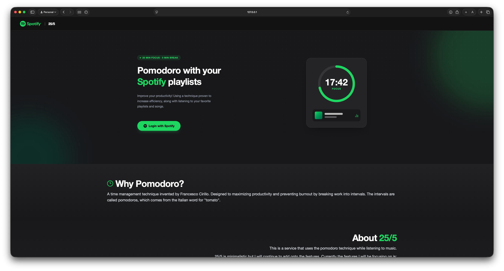

# 25/5 — Pomodoro with your Spotify playlists



## About the project

25/5 is a Pomodoro timer that plays your own Spotify playlists while you work: 25 minutes of focus, 5 minutes of break. You log in with Spotify, pick a playlist from your library, and start the timer.

It's built with Angular 19, Tailwind CSS and PrimeNG, and uses the Spotify Web API and Web Playback SDK.

## Editing the timer

The timer defaults to **25 minutes of focus** and **5 minutes of break**, but you can change both before you start:

- **Focus time:** click the time in the middle of the timer (the one with the ✏️ pencil icon), type a new time as `mm:ss`, and press **Enter** or click away.
- **Break time:** change the **Break** field under the timer (also `mm:ss`).
- **Intervals:** change the **Intervals** field to set how many focus/break rounds to run.

The focus time can only be edited **before** you press Start. Once the timer is running or paused, it's locked. Press **Reset** to unlock it and change it again.

## Authorization Code with PKCE flow

The app uses Spotify's [Authorization Code with PKCE flow](https://developer.spotify.com/documentation/web-api/tutorials/code-pkce-flow). This is the flow meant for apps that run entirely in the browser, so there is **no client secret**. Only the Client ID is needed.

1. When you click "Login with Spotify", the app creates a random `code_verifier` and saves it in the browser.
2. It sends a hashed version of it (the `code_challenge`) to Spotify along with the login request.
3. After you log in, Spotify redirects back to `/callback` with a one-time code.
4. The app exchanges that code and the original `code_verifier` for an access token. Spotify checks that the two match.

All of this lives in `src/app/services/auth/auth.service.ts`.

## Running it yourself

1. Create an app in the [Spotify Developer Dashboard](https://developer.spotify.com/dashboard).
2. Add this as a Redirect URI and click **Save** (Spotify no longer accepts `localhost`):
   ```
   http://127.0.0.1:4200/callback
   ```
3. Copy your app's **Client ID** into `src/app/services/auth/auth.service.ts`:
   ```ts
   private clientId = 'YOUR_SPOTIFY_CLIENT_ID';
   ```
4. Install and start the app:
   ```bash
   npm install
   npx ng serve --host 127.0.0.1
   ```
5. Open **http://127.0.0.1:4200** (not `localhost:4200`, or the login won't complete).

**Note:** the Spotify account that owns the app needs **Spotify Premium**. See below.

## Why I stopped working on it

In February 2026, Spotify changed its developer rules so that apps in Development Mode only work if the app owner has a Spotify Premium subscription ([Spotify's announcement](https://developer.spotify.com/documentation/web-api/references/changes/february-2026)). Without it, every API call returns `403 Forbidden`, including loading your profile and playlists, not just playback.

I no longer have a Spotify Premium account, so I'm not able to continue developing this project. The timer still works on its own, and the code is here if you have Premium and want to pick it up.
